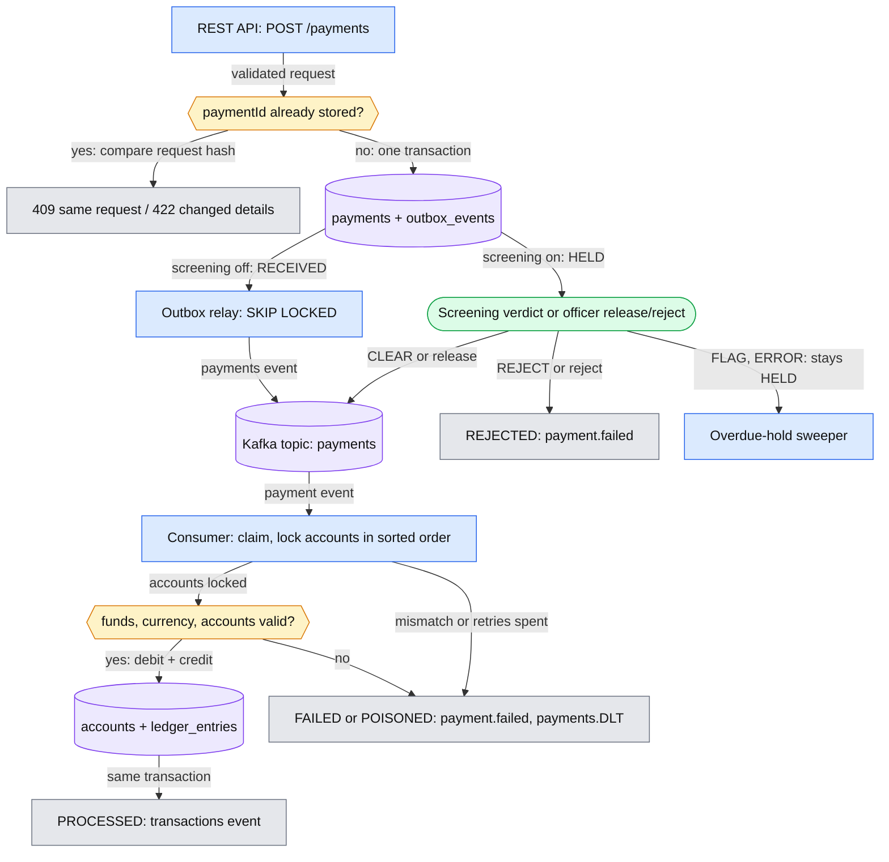

# payment-event-service

[](https://github.com/vinaykumar101997/payment-event-service/actions/workflows/ci.yml)

A payment service that moves money between accounts correctly, even when requests are repeated, payments collide, or part of the system fails.


*Run with `bash scripts/demo.sh`: a payment is accepted (201), the same request retried returns 409 with the original payment and no second charge, the same payment ID with a different amount returns 422, and the payment settles with the balances moved once.*

## What it is

A client sends a payment request, for example "move $25 from account A to account B". The service records it, processes it in the background through Kafka, and keeps a ledger of every debit and credit, the same way a bank keeps its books. Other systems are told about each outcome through events.

## Why it's harder than it sounds

Taking money from one account and adding it to another looks simple. The hard part is everything that can go wrong around it:

- **The same request arrives twice.** A mobile app retries after a timeout. The customer must still be charged only once.
- **Two payments hit the same account at the same moment.** The balance must never drop below zero.
- **Something fails halfway.** The database is slow, Kafka is down, or a process crashes. Money must never leave one account without arriving in the other, and no payment may be lost.
- **A message is wrong.** A corrupted or tampered message must not be able to change how much money moves.

The service is built around these cases, and each one is covered by automated tests that run against a real Postgres database and a real Kafka broker.

## How a payment flows

1. The client sends the payment to the REST API. The service validates it and saves it with the status RECEIVED. (With screening switched on it is saved as HELD instead and waits for a screening verdict or an officer; see [Screening hold](#screening-hold).)
2. In the same database transaction, it writes a note that the payment needs processing. A background relay publishes that note to Kafka.
3. A consumer picks up the message, claims the payment, locks both accounts, checks the balance, moves the money and writes two ledger entries.
4. The result is published as an event: `transactions` when the payment succeeds, `payment.failed` when it is declined.
5. Unexpected errors are retried. A payment that keeps failing ends up in a dead-letter topic for investigation.

## Results

What the integration tests prove, against real Postgres and Kafka:

| Scenario | Outcome |
|---|---|
| 100 payments at once against one account that can cover only 60 | Exactly 60 succeed, 40 are declined, the balance ends at exactly 0 |
| Transfers in both directions between two accounts at the same time | No deadlocks, total money conserved |
| The same payment request sent twice | Charged once, the repeat gets 409 |
| Kafka publishing fails several times in a row | The event is still delivered, money moves exactly once |
| A message whose amount disagrees with the saved payment | No money moves, the payment is failed for investigation |
| Ledger reconciliation after concurrent workloads | Every payment nets to zero, every balance matches its entries |

Unit and integration tests cover each scenario above (see [Verification](#verification)).

## Design decisions

The short version is below. [docs/DESIGN.md](docs/DESIGN.md) has the reasoning behind each decision, the bugs found so far and the tests that guard them, and the recorded screening walkthrough.

**Asking twice never pays twice.** If the same payment request arrives again, the service recognises it and returns the original result.
*Technical:* the payment id is the primary key. A SHA-256 hash of the request separates a genuine retry (409) from a reused id with different details (422). On the Kafka side, a conditional `UPDATE ... WHERE status = 'RECEIVED'` claims each payment exactly once.

**The database is the source of truth.** The processor trusts the saved payment, not the message that triggered it, so a corrupted or tampered message can't change the amount.
*Technical:* after claiming, `process()` uses only the stored row. If the message disagrees with it, the payment fails and the message goes to the dead-letter topic.

**One payment at a time per account.** When two payments reach the same account together, one waits for the other, so every balance check is accurate.
*Technical:* both accounts are locked with a JPA pessimistic write lock, which Hibernate sends to Postgres as `SELECT ... FOR NO KEY UPDATE`, always in sorted order so opposite transfers can't deadlock. Validation happens after the lock is taken, never before. `FOR NO KEY UPDATE` (rather than `FOR UPDATE`) leaves the foreign-key check of a new payment for the same account unblocked.

**Books that always balance.** Every transfer writes a matching debit and credit, and a reconciliation check confirms the totals line up. The database itself refuses a negative balance.
*Technical:* `ledger_entries` are written in the same transaction as the balance change. CHECK constraints enforce `balance >= 0`, `amount > 0` and different source and destination accounts.

**No lost notifications.** The note telling other systems about a payment is saved together with the payment itself, so either both happen or neither does.
*Technical:* transactional outbox. A relay claims rows with `FOR UPDATE SKIP LOCKED`, publishes them and retries failures with backoff. Delivery is at-least-once, so consumers deduplicate by payment id.

**A declined payment is not a crash.** Insufficient funds is a normal answer and is reported as a failed payment. Only genuine faults go to a separate "needs attention" queue.
*Technical:* business failures publish `payment.failed`. The dead-letter topic receives only mismatched events and payments that exceed the retry limit (they are marked POISONED).

**Nothing waits forever, and amounts make sense.** A stuck database lock fails fast instead of freezing the service, and amounts are checked against each currency's rules.
*Technical:* Postgres `lock_timeout` and `statement_timeout` are set for application connections. Decimal places are validated per currency (JPY has none) using `java.util.Currency`, and the maximum amount is configurable per currency. Database migrations run on their own connection without the statement timeout, so a long migration isn't cancelled at start-up.

**Clear, consistent errors.** Every error response has the same shape, so client applications can handle them reliably.
*Technical:* RFC 9457 problem details (`application/problem+json`) with a stable `type` per error, each resolving to its entry in [docs/problems.md](docs/problems.md).

## Architecture



*The diagram is simplified. A released payment is written back to the outbox and published by the relay like any other; a screening request also leaves through the relay to the external screening service; a payment with no verdict stays held and is flagged overdue by the sweeper; and FAILED or POISONED covers validation failures, event mismatches and exhausted retries, the last two also going to the dead-letter topic.*

## Tech stack

| Area | Tools |
|---|---|
| Language and framework | Java 17, Spring Boot 3.5, Spring Data JPA (Hibernate) |
| Database | PostgreSQL, Flyway migrations |
| Messaging | Apache Kafka (KRaft mode), Spring Kafka, dead-letter topics |
| Testing | JUnit 5, Mockito, AssertJ, Awaitility, Testcontainers |
| Build and delivery | Maven wrapper, Docker, Docker Compose, GitHub Actions |

## Running locally

```bash
export PAYMENTS_API_KEY=$(openssl rand -hex 32)   # any value; clients must send it
docker compose up --build
```

This starts Postgres, a single-node Kafka broker and the app on port 8080. Accounts `ACC-1001` and `ACC-1002` are created for you. Compose refuses to start the app if `PAYMENTS_API_KEY` is not set; no key is stored in the repository.

```bash
curl -X POST localhost:8080/payments -H "X-API-Key: $PAYMENTS_API_KEY" -H "Content-Type: application/json" -d '{
  "paymentId": "p-1", "fromAccount": "ACC-1001", "toAccount": "ACC-1002",
  "amount": 25.00, "currency": "USD"
}'
curl -H "X-API-Key: $PAYMENTS_API_KEY" localhost:8080/payments/p-1
curl -H "X-API-Key: $PAYMENTS_API_KEY" localhost:8080/accounts/ACC-1001
```

To run the app from your IDE instead, start Postgres and Kafka with `docker compose` and set `DB_PASSWORD` (the compose file uses `local-dev-only-not-a-secret`) and `PAYMENTS_API_KEY`. The app does not start without `PAYMENTS_API_KEY`.

## Run the demo

```bash
bash scripts/demo.sh
```

Needs only Docker and curl. It starts the stack, then shows the seeded balances, a payment being accepted (201), the same request retried (409 with the original payment, no second charge), the same `paymentId` reused with a different amount (422), and the payment read back as PROCESSED with the balances moved once. It removes the stack and its volumes at the end; set `DEMO_KEEP=1` to keep it running or `DEMO_PAUSE` (seconds, default 1) to slow it down.

## Running tests

```bash
./mvnw test      # unit tests, no Docker needed
./mvnw verify    # unit + integration tests (Docker must be running)
```

The integration tests start real Postgres and Kafka containers once per test run and share them across test classes.

## Verification

The build runs 81 unit tests and 78 integration tests, all passing. CI runs `./mvnw -B verify` on a fresh checkout on every push to `main` and every pull request (badge above).

## Screening hold

Optional fraud screening by a separate service (the plan is a Python service; it is not in this repository). Off by default (`payments.screening.enabled=false`); with it off, everything above is unchanged, which `ScreeningDisabledEndToEndIT` checks. When it is on, a new payment is saved as HELD and the service publishes a `payment.screening.requested` event instead of the `payments` event, so nothing can move its money until a screening verdict or a compliance officer releases it. Nothing ever releases a payment automatically. The event formats are JSON Schemas (draft 2020-12) in [`contracts/`](contracts/README.md), shared with the screening service; incoming verdicts are validated against them.

### Payment status transitions

| From | Trigger | To | Also |
|---|---|---|---|
| (new) | `POST /payments`, screening off | `RECEIVED` | outbox `payments` |
| (new) | `POST /payments`, screening on | `HELD` | outbox `payment.screening.requested` |
| `HELD` | verdict CLEAR | `RECEIVED` | outbox `payments` |
| `HELD` | officer release | `RECEIVED` | outbox `payments`; officer, note, time in `officer_decisions` |
| `HELD` | verdict FLAG or ERROR | `HELD` | none |
| `HELD` | verdict REJECT | `REJECTED` | outbox `payment.failed` |
| `HELD` | officer reject | `REJECTED` | outbox `payment.failed`; officer, note, time in `officer_decisions` |
| `HELD` | held longer than `payments.screening.timeout` (default 1 hour) | `HELD` | `overdue_at` set once, WARN log line, `HeldPaymentOverdueHook` called; never released or rejected |
| `RECEIVED` | consumer claims it | `PROCESSING` | none |
| `PROCESSING` | money moved | `PROCESSED` | ledger entries, outbox `transactions` |
| `PROCESSING` | business rule failed (funds, currency, account), or the event doesn't match the stored row | `FAILED` | outbox `payment.failed` |
| `RECEIVED` | `payments.processing.max-attempts` non-business failures | `POISONED` | message to `payments.DLT` |

Every verdict event is stored in `screening_verdicts` (migration V9) under the key (paymentId, eventId), with what it did. A redelivered event changes nothing. A verdict for a payment that has already left `HELD` is stored as `IGNORED_NOT_HELD` and not applied, so a payment is never decided twice. A verdict that doesn't match the schema, or names an unknown payment, goes to `payment.screening.completed.DLT` unchanged and is never applied.

Officer decisions (migration V11) are stored once per payment with officer, note and time. Repeating the same decision returns 200 and changes nothing (the first officer and note stay). The opposite decision afterwards, or a decision on a payment a verdict already decided, is 409 `payment-not-held`. A verdict and an officer decision on the same payment lock the payment row, so they are applied one after the other.

`PROCESSED`, `FAILED`, `POISONED` and `REJECTED` are terminal. From `RECEIVED` on, a released payment follows exactly the same path as one created with screening off. Postgres also enforces the list of statuses (constraint `payments_status_known`, migration V8).

### Listing held payments

`GET /payments?status=HELD` is the officers' work list. Items come oldest first (by `heldSince`, ties by `paymentId`):

```json
{
  "items": [
    {
      "paymentId": "p-2", "amount": 10.00, "currency": "USD",
      "fromAccount": "ACC-1001", "toAccount": "ACC-1002",
      "heldSince": "2026-10-15T12:00:00.123456Z", "overdue": false,
      "reasons": ["name match"], "riskScore": null
    }
  ],
  "nextCursor": null
}
```

`reasons` and `riskScore` come from the latest recorded verdict for the payment, and are both `null` if it has none. `overdue=true` returns only payments marked overdue, `overdue=false` only the others. Pagination uses a cursor: pass `nextCursor` back as `cursor` to get the next page; `null` means there are no more. The cursor holds the last item's position (`heldSince`, `paymentId`), so a payment released between two requests doesn't make the next page skip or repeat anything.

### Topics

| Topic | Direction | Key | Content |
|---|---|---|---|
| `payment.screening.requested` | published (outbox) | paymentId | [`payment.screening.requested.v1`](contracts/payment.screening.requested.v1.schema.json): schemaVersion, eventId, paymentId, accounts, amount as a decimal string, currency, createdAt |
| `payment.screening.completed` | consumed | paymentId | [`payment.screening.completed.v1`](contracts/payment.screening.completed.v1.schema.json): verdict CLEAR, FLAG, REJECT or ERROR, reasons, optional riskScore, decidedAt, screeningRunId. Read as plain JSON; no Spring type headers needed |
| `payment.screening.completed.DLT` | published | as received | verdict records that failed the schema or name an unknown payment, byte for byte; also valid verdicts that still failed after about 10 seconds of retries |

The three topics are created (3 partitions each) only when screening is on. `payments`, `transactions`, `payment.failed` and `payments.DLT` are unchanged.

### Running with screening on

Settings (environment variable form in brackets):

- `payments.screening.enabled` (`PAYMENTS_SCREENING_ENABLED`): `true` to hold new payments. Default `false`.
- `payments.screening.timeout` (`PAYMENTS_SCREENING_TIMEOUT`): ISO-8601 duration after which a HELD payment is marked overdue. Default `PT1H`.
- `payments.screening.overdue-sweep-interval-ms`: how often the overdue check runs. Default 60000.

To try it without the screening service, play its part with Kafka's console producer: the commands and their recorded output are in [docs/DESIGN.md](docs/DESIGN.md#demo-walkthrough).

## API

| Method | Path | Purpose |
|---|---|---|
| POST | `/payments` | Submit a payment |
| GET | `/payments/{id}` | Payment status and failure reason |
| GET | `/payments?status=HELD` | Held payments, oldest first. Optional `overdue=true` or `false`, `limit` (1 to 200, default 50), `cursor` |
| GET | `/accounts/{id}` | Account balance |
| POST | `/payments/{id}/release` | Officer releases a HELD payment. Body `{"officer": "...", "note": "..."}`, both required |
| POST | `/payments/{id}/reject` | Officer rejects a HELD payment. Same body |

Every request needs the header `X-API-Key` with the value of `PAYMENTS_API_KEY` (required, no default). The comparison is constant-time (SHA-256 digests compared with `MessageDigest.isEqual`). The service has no actuator endpoints.

Errors are `application/problem+json`: 401 `unauthorized` (missing or wrong key; same answer for both); 400 `invalid-query` (list parameters), `validation-failed`, `malformed-request`, `invalid-request`, `invalid-amount`; 404 `not-found`; 409 `duplicate-payment` (includes the existing payment), `payment-not-held` (officer decision on a payment that isn't HELD; includes it); 422 `unknown-account`, `payment-id-reused`; 503 `service-busy` (with `Retry-After`).

Each problem `type` is `payments.problem-base-uri` + the slug. By default that resolves to the matching section of [docs/problems.md](docs/problems.md) (for example `https://github.com/vinaykumar101997/payment-event-service/blob/main/docs/problems.md#invalid-amount`), which gives the status, when it occurs, an example body and what the client should do. Set `PAYMENTS_PROBLEM_BASE_URI` to publish them elsewhere.

## Known limitations

- **The sweeper is a safety net, not the main delivery path.** If processing keeps failing with a retryable error for longer than the consumer's retries, the message goes to the dead-letter topic and the payment stays RECEIVED. The sweeper re-enqueues such payments after 60 seconds.
- **A payment on a permanently locked account never finishes and is never poisoned.** A lock timeout (Postgres `lock_timeout`, SQLState 55P03) is retried but not counted toward the poison limit, so a busy account can't push a valid payment to POISONED. The flip side: if the account stays locked, the payment cycles through Kafka retries, the dead-letter topic and the sweeper until the lock is released. Each lock timeout is logged.
- **A payment can't be created while something else holds one of its accounts `FOR UPDATE`.** Inserting a payment checks its foreign keys, which needs a `FOR KEY SHARE` lock on both accounts; only `FOR UPDATE` blocks that. The service itself never takes `FOR UPDATE` on accounts (payment processing uses `FOR NO KEY UPDATE`), but a script or manual `SELECT ... FOR UPDATE` can. If the wait passes `lock_timeout`, the POST returns 503 `service-busy` with `Retry-After: 1`, and the client retries with the same `paymentId`.
- **Outbox retention deletes, it does not archive.** Published outbox rows older than `outbox.retention.days` (default 30) are deleted hourly in batches; dead and pending rows are kept. There is no archive, so the audit trail in `outbox_events` only goes back that far.
- **Limits are per payment and change only on restart.** `payments.max-amount-by-currency` sets a cap per currency (falling back to `payments.max-amount`). There are no per-account or per-day limits.
- **Migrations have no statement timeout.** Flyway runs on its own connection without `statement_timeout` (it keeps `lock_timeout`), so a runaway migration is stopped only by a lock timeout or an operator.
- **Problem type URIs point at `main` on GitHub by default.** A client reads the latest [docs/problems.md](docs/problems.md), not necessarily the version deployed. Set `PAYMENTS_PROBLEM_BASE_URI` per environment to change it.
- **One API key for every client.** All clients share `PAYMENTS_API_KEY`; there are no per-client keys or roles. Changing the key needs a restart.
- **Officer decisions are not individually authenticated.** The `officer` name is self-asserted: anyone holding the shared API key can release or reject a payment under any name, and the fix (OpenID Connect identity from the token's `sub` claim, an officer role, four-eyes approval) is described under [Production hardening](docs/DESIGN.md#production-hardening).
- **Event order per payment is not guaranteed once a payment can have two events on the same topic.** Today each payment has at most one event per topic, so it doesn't matter yet. Future reversals would need ordered publishing per key.
- **No screening service here.** This repository only publishes requests, consumes verdicts and holds payments; the Python screening service is separate and not built.
- **Overdue is a log line only.** `HeldPaymentOverdueHook` has no implementation (metrics are out of scope), so the WARN line is the only signal.
- **Dead-lettered verdicts are not replayed.** A verdict on `payment.screening.completed.DLT` stays there; its payment stays HELD until another verdict or an officer decides.
- **A lost screening request is not re-sent.** If its outbox row goes dead, the payment stays HELD and only shows up as overdue.
- **Switching screening on doesn't screen older payments.** Only payments created while it is on are held; switching it off doesn't release HELD ones (verdicts are then not consumed, officers can still decide).
- **`riskScore` is stored, never used.**

## Roadmap

- ISO 20022 messages: accept pacs.008, return pacs.002 status reports, generate camt.053 statements from the ledger
- Reversals using compensating ledger entries
- Metrics (Micrometer, Prometheus), OpenTelemetry tracing, payment id as a correlation id
- Load and chaos tests: throughput and p95/p99 latency with k6, a consumer killed mid-payment
- Per-client API keys or OAuth 2 client credentials, with an officer role for release and reject

## License

[MIT](LICENSE)
